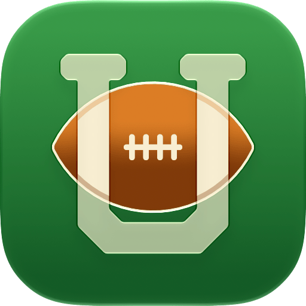

# Outrank: CFB Stat Rankings

See where your college football team ranks. Outrank shows every FBS team's national ranking in 47 statistics, from Scoring Offense to Turnover Margin, updated twice a day through the season.

[Download on the App Store](https://apps.apple.com/us/app/outrank/id1588983785)

## Features

- **Rankings:** one team's ranking in every stat, sorted however you like, and every team's ranking in any one stat.
- **Compare:** two teams side by side, stat by stat.
- **History:** a chart of how a team's ranking in a stat has moved day by day, for every season since 2021. Included with a subscription.
- **Widgets:** a team's four best or four worst stats on the Home Screen.
- **Favorites:** your teams, synced across your devices with iCloud.

It runs on iPhone, iPad and Mac (as the iPad app on Apple silicon), and adapts to both displays of iPhone Duo.

## How it's built

Swift 6 and SwiftUI, with no third-party dependencies. It requires iOS 26.

| Folder | Holds |
| --- | --- |
| `Outrank/App` | The app's entry point, its tabs, and restoring where you last were |
| `Outrank/Rankings`, `Compare`, `History`, `Settings` | One folder per tab: its views and the `@Observable` model behind them |
| `Outrank/Networking` | `RankingsAPI`, the one client for the backend, shared with the widget |
| `Outrank/Models` | The teams, the stats, and the API's response types |
| `Outrank/Store` | Subscriptions and tips, with StoreKit 2 |
| `Outrank/Persistence` | Favorite teams, in Core Data synced through CloudKit |
| `Outrank/Screenshots` | A Debug-only mode that loads sample data for App Store screenshots |
| `TopFourWidget` | The widget extension |
| `OutrankTests` | Unit tests, written with Swift Testing |

Each screen's model loads what it shows through `RankingsAPI` and refetches only once its data has gone stale, so moving between tabs doesn't hit the network.

## The backend

The app reads from a small serverless backend I also wrote (its repository is private):

- **A scraper** runs on AWS Lambda twice a day. It collects every team's ranking in every stat from ncaa.com and refuses to save anything if a page comes back wrong, so a bad scrape never replaces good rankings.
- **One DynamoDB table** holds the latest rankings and a snapshot of each in-season day.
- **A read-only JSON API** at `api.outrankapp.com`, built on API Gateway and Lambda, serves the app: a team's rankings, a stat's rankings, a team's history for a season, and when the data was last refreshed.
